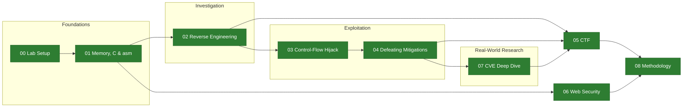

# Vulnerability Research Portfolio


I'm **Amichai Mukades** - a Computer Science student at JCT and a Unit 8200 veteran, aiming for a role in **offensive security**, with a focus on **vulnerability research**. This repository is a self-directed research track that follows one thread - how a program behaves at the lowest level - from memory layout, through reverse engineering and exploitation, all the way to the analysis of a real-world CVE.

Every stage lives in its own folder and counts as done only when that folder is complete and documented: source, debugger sessions, and a write-up explaining what was tested, what was observed, and *why*. Most stages also ship a `verify.sh` that rebuilds the targets from source and re-asserts every claim - so the findings are reproducible, not just described.

All work was done in an isolated lab VM, against my own code, intentionally vulnerable targets, and legal training platforms.

## What's in the repo

| # | Stage | Focus | Status |
|:-:|-------|-------|:------:|
| 00 | [Lab Setup](./00-lab-setup/) | Isolated Ubuntu VM, toolchain, snapshot & rollback policy | Done |
| 01 | [Foundations](./01-foundations/) | x86-64 memory layout, stack frames, C & assembly | Done |
| 02 | [Reverse Engineering](./02-reverse-engineering/) | Reading binaries without source (Ghidra, objdump) | Done |
| 03 | [Binary Exploitation I](./03-binexp-control-flow/) | Stack overflow and control-flow hijack (ret2win) | Done |
| 04 | [Binary Exploitation II](./04-binexp-defeating-mitigations/) | Defeating mitigations: NX, ASLR, canaries (ret2libc) | Done |
| 05 | [CTF](./05-ctf/) | picoGym, pwn.college | Done |
| 06 | [Web Security](./06-web/) | PortSwigger Web Security Academy, vulnerability report | Done |
| 07 | [CVE Deep Dive](./07-cve-analysis/) | CVE-2021-41773 (Apache path traversal) + CVE-2021-44228 (Log4Shell) | Done |
| 08 | [Methodology](./08-methodology/) | Research journal, interview prep | Done |



**The logic:** first understand how software is laid out in memory (01), then read binaries without source (02), then take control of a vulnerable program (03) and learn to bypass modern defenses (04). CTFs (05) and web security (06) sharpen and widen the attack surface. Everything is then applied to real vulnerabilities (07), and the approach itself is written down (08).

## Capabilities demonstrated

- **Memory & program internals** - mapping a stack frame from the disassembly and confirming it live in `gdb`: buffer, saved `rbp`, return address, alignment padding, and why a bounded read stops an overflow. ([01](./01-foundations/))
- **Reverse engineering** - reading stripped, no-PIE binaries with no source: locating `main`, recovering a plaintext and an XOR-obfuscated password, and tying each argument register to the System V ABI. ([02](./02-reverse-engineering/))
- **Binary exploitation** - measured-offset stack overflows and control-flow hijack, then four ways past NX / ASLR / stack canary when the binary has no argument-control gadget: restored gadget + leak, static-link `execve`, and a format-string leak into ret2libc. ([03](./03-binexp-control-flow/), [04](./04-binexp-defeating-mitigations/))
- **Web security** - SQL injection, XSS, broken access control and SSRF on PortSwigger, each taken to its root cause and a code-level fix, plus a client-style vulnerability report. ([06](./06-web/))
- **Real-world CVE analysis** - two in-the-wild RCE CVEs reproduced in an isolated lab and analyzed to root cause, including why the first patch failed and how a defender detects exploitation. ([07](./07-cve-analysis/))
- **Applied under CTF conditions** - eleven black-box picoGym / pwn.college challenges across binary exploitation, reverse engineering and web, sometimes against a remote target. ([05](./05-ctf/))

## Methodology & interview prep

A written account of how I approach an unknown target - hypothesis, static evidence, dynamic evidence, a refutation test, conclusion - plus a bank of interview questions and answers across every area above. See [research-journal.md](./08-methodology/research-journal.md) and [interview-prep.md](./08-methodology/interview-prep.md).

## Lab environment

| | |
|---|---|
| OS | Ubuntu 24.04 LTS (isolated VM) |
| Compiler | gcc 13.3 |
| Debugger | gdb 15.1 + pwndbg |
| Exploit dev | Python 3.12 + pwntools |
| Containers | Docker 29 |
| Reverse engineering | Ghidra |
| Web testing | Burp Suite |

## Repository structure

```
vr-portfolio/
  00-lab-setup/                     setup.md, images/
  01-foundations/                   mem.c, mem_100.c, mem_two_buf.c, notes.md, gdb-session.txt, verify.sh, images/
  02-reverse-engineering/           crackme.c, crackme2.c, verify.sh, writeup.md
  03-binexp-control-flow/ret2win/   vuln.c, vuln2.c, vuln3.c, format-string-0.c,
                                    exploit.py, exploit2.py, exploit3.py, verify.sh, writeup.md
  04-binexp-defeating-mitigations/  ret2libc/ writeup.md, vuln.c, vuln_gadget.c, vuln_leak.c,
                                    exploit_A_gadget.py, exploit_B_static.py,
                                    exploit_C_noaslr.py, exploit_D_leak.py, verify.sh, Makefile
  05-ctf/                           writeup.md, picogym/ (binary-exploitation, reverse-engineering,
                                    web-exploitation), pwncollege/
  06-web/                           portswigger-notes.md, vulnerability-report.md
  07-cve-analysis/                  CVE-2021-41773/ (writeup.md, poc-notes.md),
                                    CVE-2021-44228/ (writeup.md, poc-notes.md)
  08-methodology/                   research-journal.md, interview-prep.md
```

## Training platforms

Username on picoCTF, pwn.college and PortSwigger: `AmicaiMukades`
