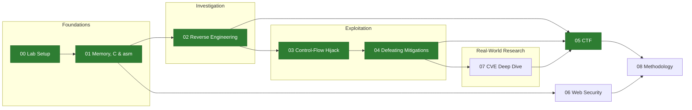

# Vulnerability Research Portfolio

A self-directed research track in vulnerability research and offensive security, from how a program looks in memory, through reverse engineering and exploitation, to a full analysis of a real-world CVE.

Every stage lives in its own folder and is considered done only when that folder is complete and documented: source code, debugger sessions, and a technical write-up explaining what was tested, what was observed, and why.

All work is done in an isolated lab VM, against my own code, intentionally vulnerable targets, and legal training platforms.

## Progress

| # | Stage | Focus | Status |
|:-:|-------|-------|:------:|
| 00 | [Lab Setup](./00-lab-setup/) | Isolated Ubuntu VM, toolchain, snapshot & rollback policy | Done |
| 01 | [Foundations](./01-foundations/) | x86-64 memory layout, stack frames, C & assembly | Done |
| 02 | [Reverse Engineering](./02-reverse-engineering/) | Reading binaries without source (Ghidra, objdump) | Done |
| 03 | [Binary Exploitation I](./03-binexp-control-flow/) | Stack overflow and control-flow hijack (ret2win) | Done |
| 04 | [Binary Exploitation II](./04-binexp-defeating-mitigations/) | Defeating mitigations: NX, ASLR, canaries (ret2libc) | Done |
| 05 | [CTF](05-ctf/) | picoGym, pwn.college | Done |
| 06 | Web Security | PortSwigger Web Security Academy, vulnerability report | Planned |
| 07 | CVE Deep Dive | CVE-2021-41773 (Apache path traversal) + one more | Planned |
| 08 | Methodology | Research journal, lessons learned | Planned |

## Roadmap



**The logic:** first understand how software is laid out in memory (01), then read binaries without source (02), then take control of a vulnerable program (03) and learn to bypass modern defenses (04). CTFs (05) and web security (06) sharpen and widen the attack surface. Finally, everything is applied to a real vulnerability and documented at a researcher's level (07).

## Completed so far

### 00: Lab Setup
- Isolated Ubuntu 24.04 VM, so untrusted code and vulnerable containers never touch the host
- Toolchain: gcc, gdb + pwndbg, Python + pwntools (virtualenv), Docker, Ghidra
- Clean baseline snapshot with a documented rollback policy, and a reproducible from-scratch install guide

See [setup.md](./00-lab-setup/setup.md)

### 01: Foundations (memory layout)
Five exercises, each verified both statically (`objdump`) and at runtime (`gdb`):

1. **Stack frame map:** located the buffer, saved `rbp` and return address; measured a **40-byte** offset from a 32-byte buffer to the return address
2. **Stack alignment:** a 100-byte buffer produces `sub rsp, 0x70` (112 bytes) because of 16-byte alignment
3. **Local variable ordering:** how GCC places two buffers in separate aligned slots, and why that is a compiler choice, not a language guarantee
4. **Bounded vs. unbounded input:** why `fgets` stopped the overflow, and what `gets` would have overwritten (padding, then saved `rbp`, then the return address)
5. **Full gdb transcript** of the session

See [notes.md](./01-foundations/notes.md) and [gdb-session.txt](./01-foundations/gdb-session.txt)

### 02: Reverse Engineering
Reading stripped, no-PIE Linux binaries without source, every finding confirmed both statically (`file`, `strings`, `readelf`, `objdump`, Ghidra) and at runtime (`gdb/pwndbg`, `ltrace`). Four exercises:

1. **crackme - visible password:** recovered `entrypt` from a `strcmp` against a stack-built string; located `main` in a stripped binary via the `rdi` set before `__libc_start_main`
2. **crackme2 - XOR obfuscation:** rebuilt the check as a byte-by-byte loop over an XOR-encrypted secret, then recovered the password from the key and encrypted bytes - XOR is reversible, so the protection only slows analysis, it doesn't block it
3. **scanf & the calling convention:** stopped at the call and read the argument registers (`rdi` = format, `rsi` = buffer) per the System V ABI
4. **picoGym challenges:** Reverse, reverse_cipher, GDB baby step 1 - a fixed string, an encryption algorithm reversed and verified by re-running the binary, and a runtime return value read with `finish`

[verify.sh](./02-reverse-engineering/verify.sh) rebuilds the binary from source and
verifies that the password check behaves as documented.

See [writeup.md](./02-reverse-engineering/writeup.md)

### 03: Binary Exploitation I
Taking control of a vulnerable program's execution flow. Every offset was measured rather than assumed - found with `cyclic` in gdb and confirmed against the disassembly. Five exercises:

1. **ret2win:** overwrote the return address at offset **72** and reached `win`; the flag printed but `system()` crashed, fixed with a single `ret` gadget for stack alignment
2. **A changed buffer size:** `buffer[88]` puts the return address at **104**, not 96 - the compiler rounds the frame up to a multiple of 16
3. **Stack canary:** the same exploit now ends in `SIGABRT` and `*** stack smashing detected ***` - the overwrite still happens, the canary only detects it
4. **An argument through `rdi`:** no `pop rdi; ret` exists since glibc 2.34 dropped `__libc_csu_init`; a static build supplies `pop rdi; pop rbp; ret`
5. **picoGym `format string 0`:** solved, plus a second path the challenge did not intend - an unbounded `scanf` into the same SIGSEGV handler

[verify.sh](./03-binexp-control-flow/ret2win/verify.sh) rebuilds all three targets from
source and checks both that the exploits work and that wrong input does not.

See [writeup.md](./03-binexp-control-flow/ret2win/writeup.md)

### 04: Binary Exploitation II (defeating mitigations)
The classic ret2libc recipe assumes a `pop rdi; ret` gadget in the binary - but glibc 2.34 removed `__libc_csu_init`, so a small no-PIE binary built against glibc 2.39 has no argument-control gadget and the classic chain can't even start. The core finding is one dependency chain that blocks every classic technique (ret2libc, ret2csu, ret2dlresolve, GOT overwrite) at the same point, and four ways past it:

1. **Escape A - restore the gadget:** bring back `pop rdi; ret` as inline asm, then a two-stage `puts` leak beats ASLR
2. **Escape B - static linking:** no leak needed - a `.bss` stack pivot plus a raw `execve` syscall, since No-PIE keeps every address fixed
3. **Escape C - ASLR off:** libc's own `pop rdi; ret` sits at a fixed address, used directly with no leak and no gadget in the binary
4. **Escape D - real leak:** a format-string bug leaks a libc pointer at runtime, then ordinary ret2libc with libc's own gadget
5. **Exercise 5 (pwn.college):** login-leakage easy + hard - bypassing a `strcmp` password check by overwriting the stored secret with a null byte (offset printed by the program in easy, found in gdb in hard)

[verify.sh](./04-binexp-defeating-mitigations/ret2libc/verify.sh) rebuilds all four targets from source, re-asserts the wall (no arg-control gadget), and checks that all four escapes get a shell.

See [writeup.md](./04-binexp-defeating-mitigations/ret2libc/writeup.md)

### 05: CTF
Applying 01-04 against real CTF challenges, usually black-box (no source) and sometimes against a remote server rather than just a local binary. Ten challenges across four categories:
 
1. **Binary Exploitation (picoGym):** Format Strings 1, Format String 2, Local Target - a stack leak with the offset calculated from the calling convention, then an arbitrary memory write (`%n`/`%hn`) on the same bug, and a buffer overflow where the real distance between variables, measured in the assembly, turned out not to match the source code
2. **Reverse Engineering (picoGym):** GDB baby step 2-4 - a loop's final register value (and exactly where to place the breakpoint), a little-endian byte order read straight out of memory, and a constant exposed as a literal operand in the disassembly alone
3. **Web Exploitation (picoGym):** Crack the Gate 1, Old Sessions, SSTI1 - a developer's backdoor hidden with a Caesar cipher, a session cookie that never expires combined with an exposed session store, and a Server-Side Template Injection that reaches full RCE through Python's class hierarchy
4. **pwn.college (Program Security):** Bounds Breaker Easy - a signed/unsigned mismatch that cancels out a bounds check that looks correct
See [writeup.md](./05-ctf/writeup.md), including an extended writeup of Format String 2 - the exercise that needed the most debugging, not just technique.

## Lab environment

| | |
|---|---|
| OS | Ubuntu 24.04 LTS (isolated VM) |
| Compiler | gcc 13.3 |
| Debugger | gdb 15.1 + pwndbg |
| Exploit dev | Python 3.12 + pwntools |
| Containers | Docker 29 |
| Reverse engineering | Ghidra |

## Repository structure

Folders are added as each stage is completed.

```
vr-portfolio/
  00-lab-setup/                     setup.md, images/
  
  01-foundations/                   mem.c, mem_100.c, mem_two_buf.c, notes.md, gdb-session.txt, images/
  
  02-reverse-engineering/           crackme.c, crackme2.c, verify.sh, writeup.md
  
  03-binexp-control-flow/ret2win/   vuln.c, vuln2.c, vuln3.c, format-string-0.c,
                                    exploit.py, exploit2.py, exploit3.py,
                                    verify.sh, writeup.md
  
  04-binexp-defeating-mitigations/  ret2libc/ writeup.md, vuln.c, vuln_gadget.c, vuln_leak.c,
                                    exploit_A_gadget.py, exploit_B_static.py,
                                    exploit_C_noaslr.py, exploit_D_leak.py,
                                    verify.sh, Makefile
  
  05-ctf/                           writeup.md,
                                    picogym/binary-exploitation/ (format-string-1, format-string-2, local-target),
                                    picogym/reverse-engineering/ (gdb-baby-step-2, -3, -4),
                                    picogym/web-exploitation/ (crack-the-gate-1, old-sessions, ssti1),
                                    pwncollege/ writeup.md
  
  06-web/                           portswigger-notes.md, vulnerability-report.md
  07-cve-analysis/                  CVE-2021-41773/, second CVE
  08-methodology/                   research-journal.md
```

## Training platforms

Username on picoCTF, pwn.college and PortSwigger: `AmicaiMukades`

---

*Amichai Mukades, Computer Science student (JCT), Unit 8200 veteran.*
